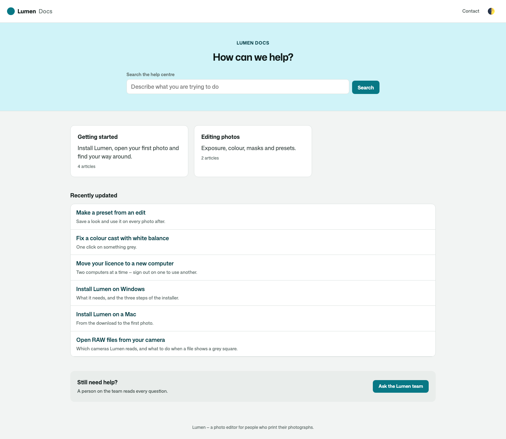
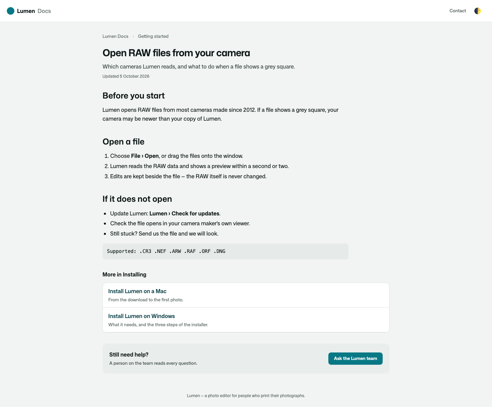
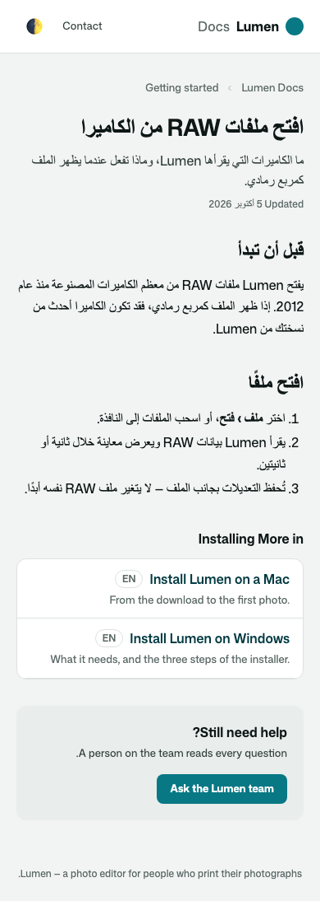
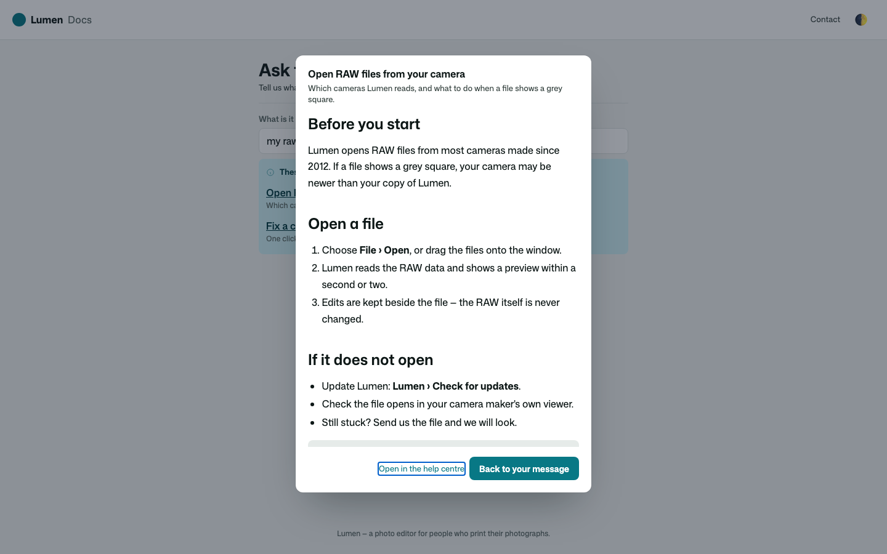
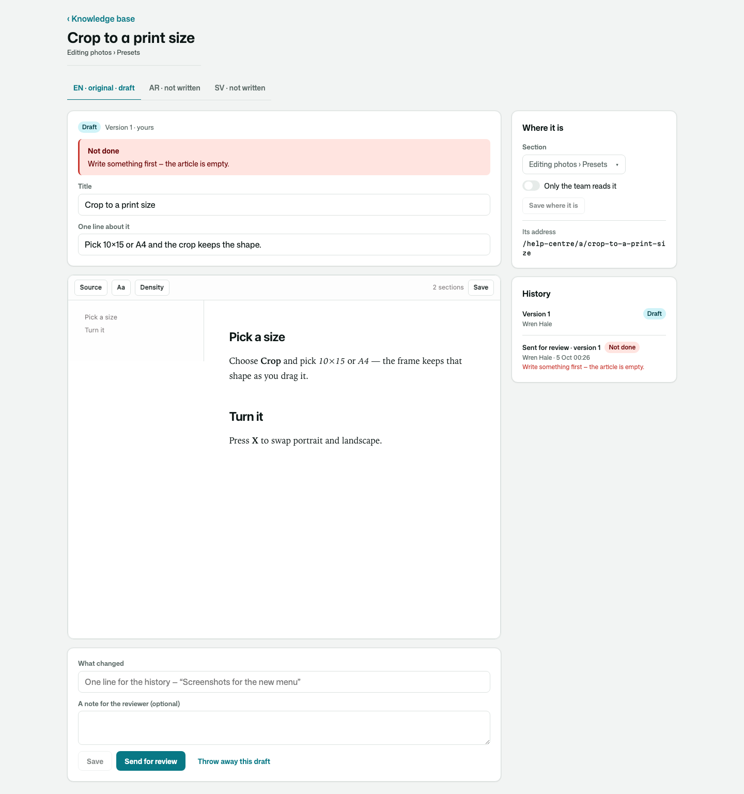
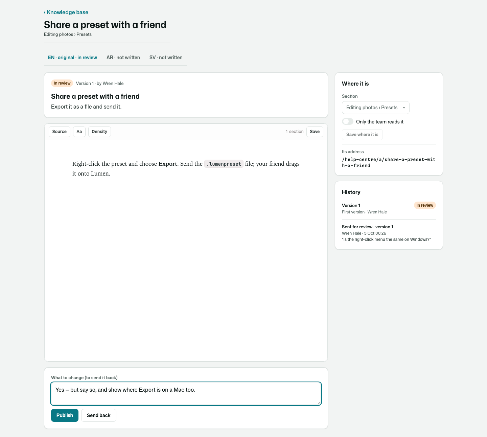

# Osysharp.KnowledgeBase

A knowledge base and the help centre it is read in. Your team writes answers in markdown, a second person reviews them
before anyone else reads them, and each answer can have a version in every language you speak. Readers search, browse
by category, and get the version in their language, or the original when there is none yet. Answers meant only for
your team stay with your team, everywhere.

**Use case.** A photo editor's documentation. Writers draft "Open RAW files from your camera"; an editor publishes it.
A Swedish reader gets the Swedish version and an Arabic reader the Arabic one. Someone typing "my raw files show a grey
square" into the contact form sees that article offered before they send. The support team's refund playbook is in the
same knowledge base, and no reader ever finds it. The same kit runs a support desk's help centre, a product's docs or a
school's handbook: it never knows what the answers are about.

```osy
use Osysharp.KnowledgeBase@1;

policy ReadsTeamKnowledge => IsStaff;     // reads the articles only the team may read
policy WritesKnowledge => IsStaff;        // writes drafts and sends them for review
policy ReviewsKnowledge => IsEditor;      // publishes, sends back, archives
policy ManagesKnowledge => IsAdmin;       // categories, sections and settings

app.Knowledge = new KnowledgeSetup { Name = "Lumen Docs", ContactPath = "/contact" };

// a contact form whose subject offers articles as it is typed
KnowledgeSuggestingField("What is it about?", value: subject);

// a search small enough for a chat panel
KnowledgeQuickSearch();
```

The help centre is at `/help-centre`, the team's desk at `/knowledge`, and the settings at `/settings/knowledge`. The
desk's pages stand in your app's own shell — design `WorkspaceShell` once and they, and your settings, are drawn inside
it — and the knowledge base puts itself in your navigation (`Nav.Pages()` lists it, for the people who may write).
Design `HelpCentreFrame` once to put the whole help centre inside your site's header and footer. It is the help
centre's layout, so it stays on screen as a reader moves between pages: a search, a chat or an account in it keeps
what it holds.

## Your provider, your key

Nothing is provided, and nothing needs one. Search by words works out of the box. Search by meaning
(`KnowledgeByMeaning`) uses the embedding provider **you** choose for your app (`app.Embedding`), with **your** key as a
secret; until it has one, search keeps working by words and says so.

## What it does

| | |
|---|---|
| **Markdown articles** | written in the markdown editor, in categories and sections; a title, a line about it, and the words |
| **Drafts and versions** | one draft at a time per language; each publish is a numbered version, and an earlier one can be brought back as a new draft |
| **Review before publishing** | a reviewer who did not write a version publishes it, or sends it back saying what to change. Turn review off and a reviewer may publish their own. Each step is an event your `[On]` handler hears — `ArticleSentForReview`, `ArticleSentBack`, `ArticlePublished` — and each says itself in a bell or on a timeline ("Ada Lindqvist sent an article for review.") |
| **Nothing published by an edit** | moving a version is a step somebody takes, checked by the kit after it is saved, so a draft cannot be published by changing it |
| **Every language** | each language has its own versions. A new one starts as a copy of the original to translate; a reader with no version in their language gets the original, and the page says so |
| **For the team only** | an article, or a whole category, can be the team's. It never reaches a reader outside it: not on a page, not in a search, not in a suggestion |
| **Search** | full text over every published version, every word first and any word when nothing has them all, each article once and in the reader's language. An inflected word finds its other forms in Swedish, Danish, Norwegian, English and Arabic ("betalningen" finds "betalningar"). With an embedder, `KnowledgeByMeaning` finds the article that answers a question asked in other words, or in another language |
| **Suggestions as people type** | under a contact form's subject. An article opens over the form, so what they wrote is still there |
| **Search engines** | each page's title, description and canonical address, a `TechArticle` and its breadcrumb, every language's address, `noindex` for the team's own, and a sitemap |
| **Archive** | an archived article is read by nobody outside the team and is in no search; bring it back any time |
| **Your look** | the front page, a category, an article and the search are parts a site's look can design |
| **Personal data** | who wrote and reviewed what is classified. With `Osysharp.Privacy`, add `Osysharp.Privacy.KnowledgeBase`: a writer's name comes off their articles when they ask, and the articles stay |

## Screens

| | |
|---|---|
| The front page |  |
| An article |  |
| In Arabic, on a phone |  |
| A suggestion opened over the contact form |  |
| Writing |  |
| Reviewing |  |

## Its tests

Every behaviour above is proven against a small documentation site, and its screens are photographed with
`osy test --pixels`. Each promise about who reads what is checked to fail when its rule is taken out.
